<div align="center">

# 🐈 pixel-desk

**Un escritorio pixel-art 2.5D para Linux (X11).**<br>
Tu fondo de escritorio es una casa de cinco cuartos: un escritorio donde cada
objeto abre una app o una herramienta, un tablero de corcho, un monitor del
sistema, un calendario y un rack de servidores.


</div>

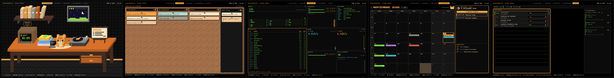

---

## ✨ Qué tiene

<table>
<tr>
<td width="50%" valign="top">

### Una habitación que lanza apps
Pasa el ratón (o usa `← →`) y el objeto salta con su etiqueta. Clic o `Enter`
lo abre. El monitor CRT marca la hora, el cielo de la ventana sigue el día y
los cajones se deslizan hacia fuera.

### Un gato de verdad (bueno, de cajas)
La mascota de la marca, en 3D con la paleta del sprite original, todo a 8 pasos
por segundo. Sentado junto a su portátil teclea de vez en cuando, mueve la cola y
parpadea. Cada pocos minutos hace algo al azar: o se levanta, da su vuelta de
gato, se enrosca y duerme 8 minutos (luego se estira delante y detrás y vuelve a
sentarse), o se tumba panza arriba moviendo las patitas. De noche (22–7 h) se
duerme pronto y sigue así hasta la mañana; de tanto en tanto alza una oreja,
abre un ojo y vuelve a dormirse.

</td>
<td width="50%" valign="top">

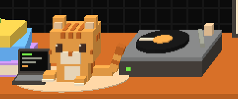

</td>
</tr>
</table>

### Claro y oscuro
`T` alterna en vivo, en cualquier cuarto. El modo claro usa la paleta de los carruseles de
cover-creator-cli: blanco, tinta azul noche y naranja `#f97316`.

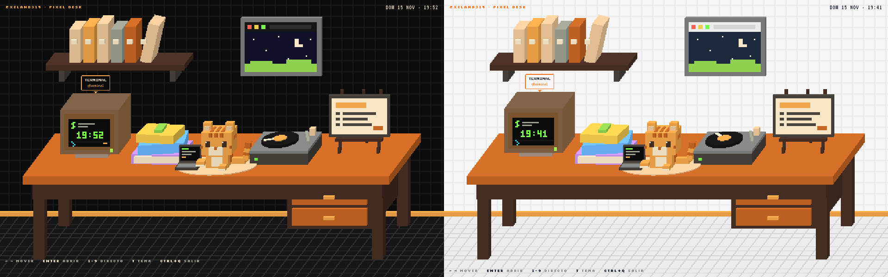

### Todo el escritorio a juego
Marcos de ventana, panel, menú, iconos y rofi salen de los mismos tokens de
color que la escena.


<details>
<summary><b>Ver la sesión en modo claro</b></summary>

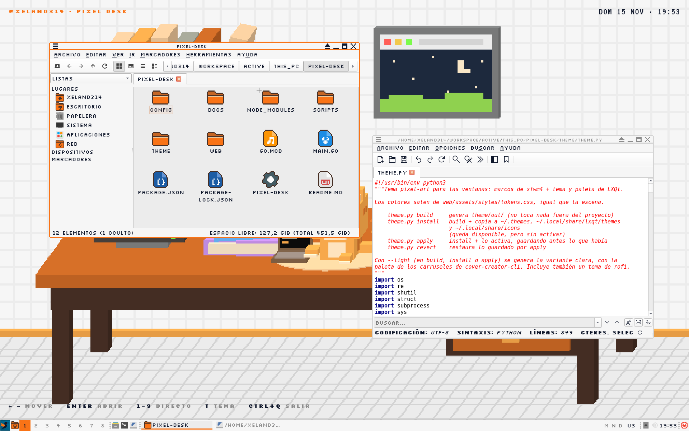

</details>

---

## 🏠 Los cuartos

`Tab` / `Shift+Tab` o las pestañas de arriba cambian de cuarto. Cada uno solo
trabaja (consulta el sistema, la red o el disco) mientras lo estás mirando.

### 2 · Tablero de corcho
Kanban de tres columnas (por hacer, en progreso, hecho) y una pizarra de
**información fija**. Notas de papel con chincheta: arrastrar y soltar, doble
clic para editar, o todo con teclado (`N` nueva, `Enter` editar, `Shift+← →`
mover, `C` color, `Supr` dos veces para borrar).

Tiene **espacios** separados, como TRABAJO y PERSONAL, cada uno con su propio
tablero. `W` o `1-9` cambian de espacio y `M` lleva la nota seleccionada al
siguiente. `Shift+N` crea un espacio, `F2` o doble clic en la pestaña lo
renombra, y `Shift+Supr` dos veces lo borra si está vacío. Un `board.json`
antiguo se migra solo: sus notas pasan a TRABAJO y el original queda como
`board.v1.json`.

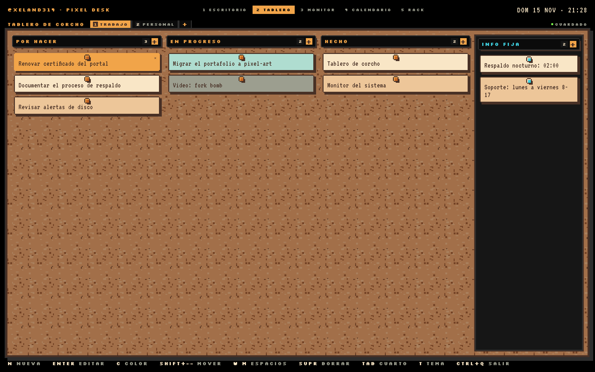

### 3 · Monitor del sistema
Pared de pantallas estilo terminal: CPU por núcleo, memoria y swap, procesos
tipo htop (`S` ordena por CPU o memoria), red, discos, sistema (temperatura,
batería, carga) y paneles que consultan una **API**. Se configura en
`~/.config/pixel-desk/monitor.json` (si no existe, usa
[`config/monitor.json`](config/monitor.json)). Lee `/proc` y `/sys`
directamente, sin ejecutar comandos.

**Otras máquinas:** un panel con `"server"` muestra otro equipo leyendo su
[Netdata](https://www.netdata.cloud/), sin instalar nada más en él (por
ejemplo, a través de Tailscale). Allí la tabla de procesos muestra los
**contenedores**. Se pide como mucho cada 2 s y solo con el cuarto a la vista.

```json
"servers": { "srv": { "name": "MI SERVIDOR", "netdata": "https://servidor:19999" } },
"panels": [
  { "type": "cpu",   "title": "SRV CPU",          "server": "srv" },
  { "type": "procs", "title": "SRV CONTENEDORES", "server": "srv", "span": [2, 2] },
  { "type": "disk",  "title": "SRV DISCOS",       "server": "srv", "mounts": ["/", "/mnt/datos"] }
]
```

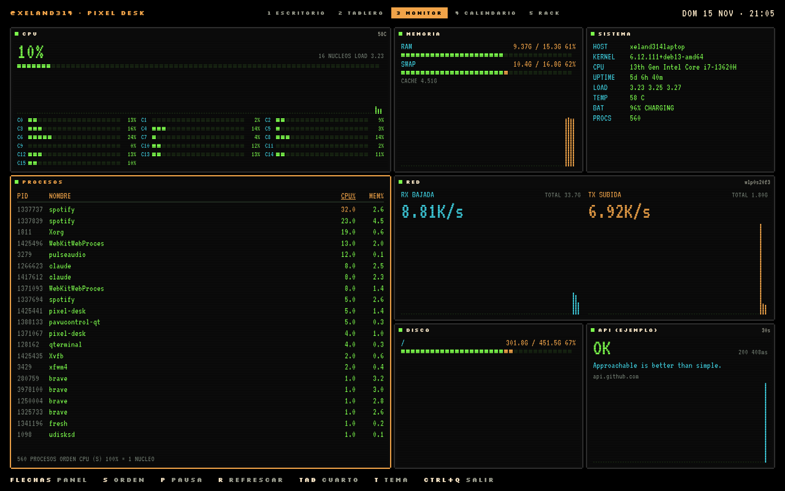

### 4 · Calendario
Mes completo (semana desde el lunes, número de semana ISO), agenda del día,
próximos 7 días, fase lunar y un gato que parpadea. Eventos con hora o de día
completo, repetición semanal, mensual o anual, y **suscripciones ICS** de solo
lectura (por ejemplo, el enlace privado de Google Calendar) en
`~/.config/pixel-desk/calendar.json`.

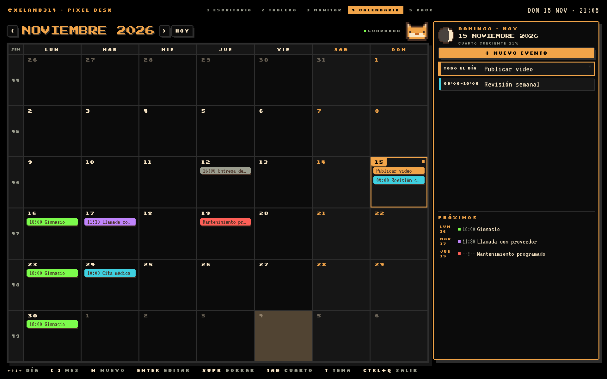

### 5 · Rack de servidores
Cada nodo es una unidad de rack con LEDs: TCP, HTTP, días restantes del
certificado TLS, ping, DNS y contenedores Docker. Las comprobaciones HTTP
aceptan `"keyword"`, igual que los monitores de palabra clave de Uptime Kuma.
`Enter` copia el `ssh` del
nodo, `R` comprueba ahora, `F` deja solo los que fallan. La lista va en
`~/.config/pixel-desk/rack.json` (se recarga sola); el ejemplo incluido solo
comprueba tu propia máquina y example.com.

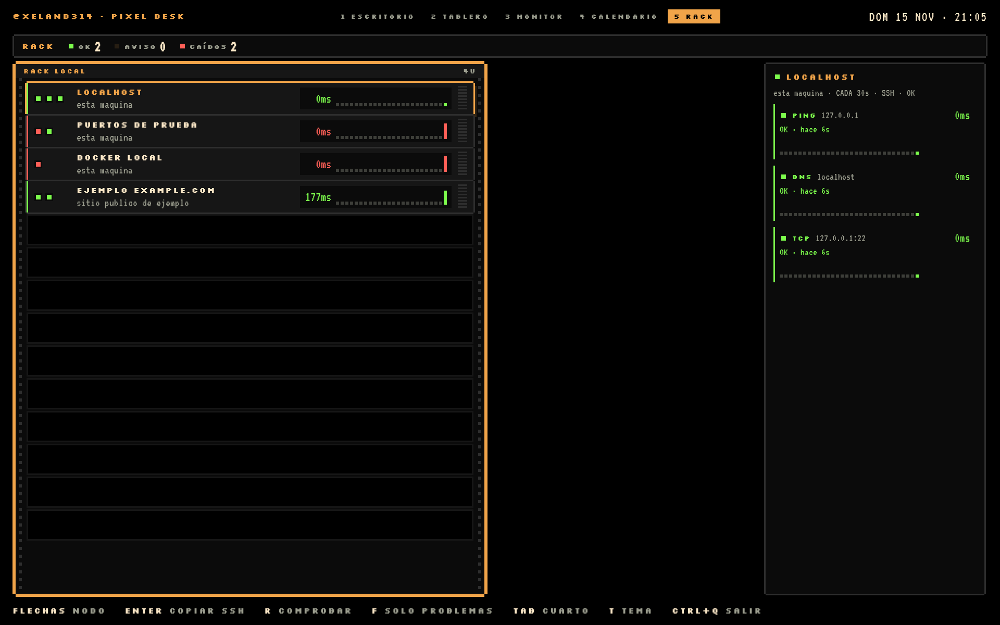

<details>
<summary><b>Ver los cuartos en modo claro</b></summary>

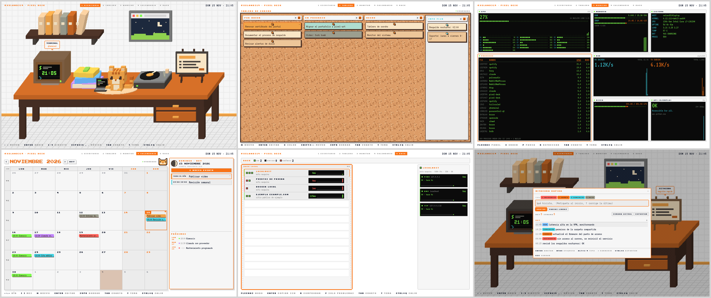

</details>

---

## 🎛️ Los objetos

| | Objeto | Abre |
|---|---|---|
| 📁 | Carpetas de la repisa | gestor de archivos (`pcmanfm-qt`) |
| 🖥️ | Monitor CRT con reloj | terminal (`qterminal`) |
| 📚 | Pila de libros (colores del resaltado de sintaxis) | VS Code |
| 🐈 | El gato con su portátil | lanzador (`rofi -show drun`) |
| 💿 | Tocadiscos | Spotify en su escritorio virtual (el 8). Seleccionado: `Espacio` pausa, `,` `.` cambian de pista y la etiqueta muestra qué suena |
| 🪟 | Ventana en la pared | navegador (Brave) |
| 🖼️ | Caballete | **bitácora rápida** (panel) |
| 🧰 | Cajón de arriba | **bóveda de comandos** (panel) |
| 🔑 | Cajón de abajo | apagar / cerrar sesión |

Todo se configura en [`config/apps.json`](config/apps.json): un objeto lanza un
programa (`cmd`) o abre un panel (`panel`). La página solo envía un `id`; el
binario ejecuta únicamente lo que está en esa lista.

### Bóveda de comandos (cajón)
Escribe para filtrar tus comandos frecuentes; `Enter` copia el elegido al
portapapeles y cierra. **Nunca ejecuta nada.** Admite huecos `{{host}}` que se
rellenan antes de copiar. Los comandos viven en
`~/.local/share/pixel-desk/snippets.json` (se crea con ejemplos genéricos).

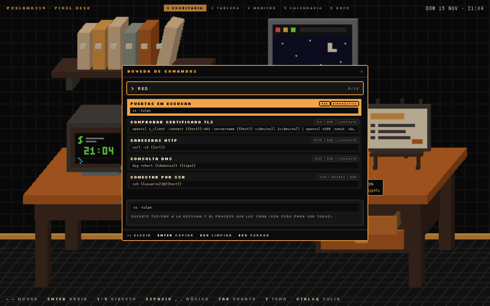

### Bitácora rápida (caballete)
Para las interrupciones del día: `Enter` anota con la hora puesta, `#etiqueta`
o `Alt+1-4` clasifican (incidencia, cambio, consulta, nota), `↑` corrige la
última y `Ctrl+E` exporta la semana a Markdown (y lo copia). El archivo
`bitacora.jsonl` es de solo añadir: nunca se reescribe.

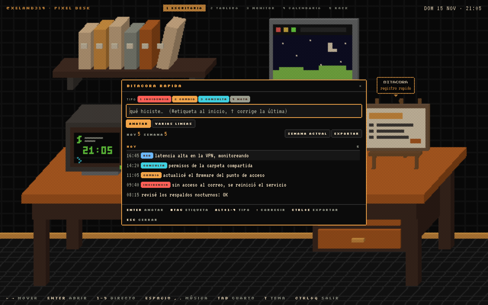

**Controles:** ratón · `← →` mover · `Enter` abrir · `1-9` directo · `Tab` cuarto · `T` tema · `Ctrl+Q` salir

---

## 🚀 Uso

```bash
nvm use            # .nvmrc → node 22.23.4
npm install        # baja three.js y lo copia a web/vendor/
npm run build      # go build → ./pixel-desk (embebe web/ y config/)

npm start          # ventana normal, sirve web/ desde disco (editar y F5)
npm run desktop    # como fondo de escritorio
npm run stop       # cerrarlo
```

| Opción | Qué hace |
|---|---|
| `-desktop` | ventana `_NET_WM_WINDOW_TYPE_DESKTOP`: detrás de todo, a pantalla completa |
| `-theme light` | arranca en modo claro (por defecto `dark`) |
| `-room N` | arranca en otro cuarto: 1 escritorio, 2 tablero, 3 monitor, 4 calendario, 5 rack |
| `-px N` | tamaño del píxel: `3` por defecto (640×400 en 1920×1200), `6` grueso, `2` fino |
| `-software` | sin aceleración por GPU |
| `-shot f.png` | guarda una captura y sale |
| `-config ruta` | otra lista de apps |

Para arrancarlo con la sesión, una entrada en `~/.config/autostart/`:

```ini
[Desktop Entry]
Type=Application
Name=pixel-desk
Exec=/ruta/a/pixel-desk/pixel-desk -desktop
Path=/ruta/a/pixel-desk
OnlyShowIn=LXQt;
```

---

## 🎨 Tema del escritorio

[`theme/theme.py`](theme/theme.py) genera e instala todo el conjunto, siempre
con copia de seguridad de lo que había:

```bash
python3 theme/icons.py                 # convierte los iconos (ver abajo)
python3 theme/theme.py apply           # instala y activa (guarda lo anterior en theme/backup/)
python3 theme/theme.py apply --light   # activa la variante clara
python3 theme/theme.py switch light    # alterna sin regenerar (o dark)
python3 theme/theme.py revert          # vuelve a como estaba
```

Las dos variantes se instalan a la vez (`PixelDesk` / `PixelDesk-Light`,
`pixel-desk` / `pixel-desk-light`). Con el tema aplicado, la tecla `T` de
pixel-desk cambia también el del sistema: pcmanfm-qt, el panel, rofi y los
marcos de las ventanas pasan a claro u oscuro en vivo. pixel-desk recuerda la
última elección para el siguiente arranque (salvo que se pase `-theme`).

| Pieza | Resultado |
|---|---|
| **xfwm4** `PixelDesk` | marcos de 3 px, esquinas escalonadas, botones con glifos 5×5; naranja la activa, gris las demás |
| **LXQt** `pixel-desk` | panel negro con línea de acento, nada redondeado, paleta Qt a juego, fuente Silkscreen |
| **Menú** | el colibrí de LXQt que trae Debian, redibujado en 12×12 |
| **rofi** | marco de 3 px, selección en bloque, fuente VT323, iconos pixel-art |
| **Iconos** `PixelDesk` | carpetas dibujadas a mano + el resto convertido |

<table>
<tr>
<td></td>
<td>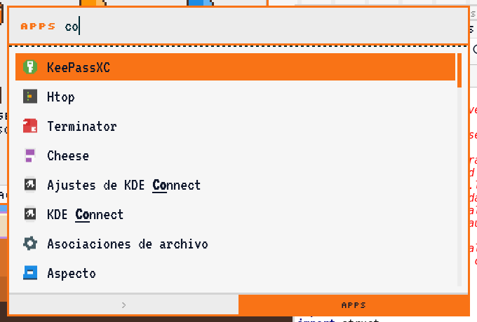</td>
</tr>
</table>

### Carpetas dibujadas a mano

Con emblema para Inicio, Escritorio, Documentos, Descargas, Música, Imágenes,
Vídeos y Red, más el monitor del botón "mostrar escritorio".

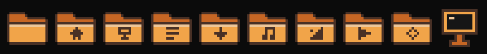

### Iconos convertidos, sin IA

[`theme/icons.py`](theme/icons.py) pasa los iconos de Papirus a pixel-art con
un algoritmo determinista:

1. rasteriza el SVG a 8 píxeles por celda;
2. cada celda de la rejilla (16×16, o 12×12 a tamaño de panel) toma su color
   **dominante**, no el promedio, para que los bordes no se enturbien;
3. reduce la paleta del icono por corte de mediana;
4. añade un contorno de una celda con el marrón del gato.

Convierte las apps instaladas, los tipos de archivo y los dispositivos
(~550 iconos en 7 s); `--all` convierte las ~3700 apps de Papirus.

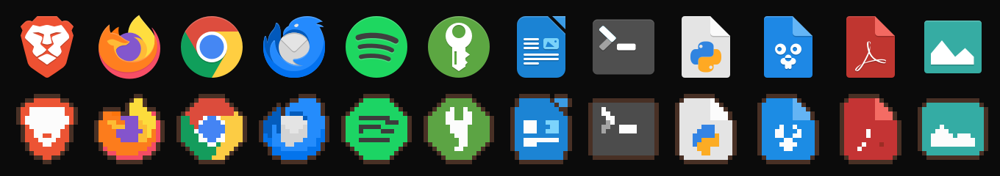

---

## 🧱 Cómo funciona

```
┌───────────────────────── pixel-desk (binario Go, 11 MB) ─────────────────────────┐
│                                                                                  │
│  ventana GTK3 ──► WebKitGTK ──► http://127.0.0.1:<aleatorio>/?t=<token>          │
│  (tipo DESKTOP)                    │                                             │
│                                    ▼                                             │
│                     web/desk.js · three.js                                       │
│                     cajas 3D en proyección oblicua, render a 640×400,            │
│                     escalado ×3 sin suavizado, animación a 8 fps                 │
│                                    │                                             │
│                     POST /api/launch?id=terminal  (cabecera X-Desk-Token)        │
│                                    ▼                                             │
│  lanzador ──► solo ids de config/apps.json ──► setsid qterminal                  │
└──────────────────────────────────────────────────────────────────────────────────┘
```

- **Pixel-art con volumen:** las caras frontales quedan 1:1 con la rejilla de
  píxeles y solo la profundidad se inclina. La luz es fija, así cada cara de una
  caja tiene un único tono, como en un sprite.
- **Sin Electron:** usa el WebKitGTK que ya trae el sistema; se enlaza contra la
  librería de runtime, así que no hace falta el paquete `-dev`.
- **Seguro por defecto:** el servidor escucha solo en `127.0.0.1`, la API exige
  un token nuevo en cada arranque, y la página no puede pedir comandos, solo ids.
  Las URLs de APIs, calendarios y servidores viven en el backend y nunca llegan
  a la página; todo texto ajeno se pinta como texto, nunca como HTML.
- **Cuartos y paneles como módulos:** cada cuarto es un archivo de
  `web/rooms/` y cada herramienta de un objeto, uno de `web/panels/`, con un
  contrato de pocas funciones (documentado en `web/rooms.js` y `web/panels.js`).

### Dónde se guardan las cosas

| Archivo | Qué es |
|---|---|
| `~/.local/share/pixel-desk/board.json` | notas del tablero |
| `~/.local/share/pixel-desk/calendar.json` | eventos del calendario |
| `~/.local/share/pixel-desk/snippets.json` | comandos de la bóveda (se edita a mano) |
| `~/.local/share/pixel-desk/bitacora.jsonl` | bitácora (solo añadir) y `reportes/` con los Markdown |
| `~/.config/pixel-desk/rack.json` | servidores del rack (lo escribes tú) |
| `~/.config/pixel-desk/calendar.json` | suscripciones ICS |
| `~/.config/pixel-desk/monitor.json` | pantallas del monitor y servidores remotos |

Se escriben de forma atómica, y si un archivo aparece corrupto se aparta como
`*.corrupto-<fecha>` en vez de perderse.

<details>
<summary><b>Estructura del proyecto</b></summary>

```
main.go             servidor local + ventana GTK/WebKit + lanzador + portapapeles
board.go            API del tablero          calendar.go   API del calendario + ICS
sysinfo.go          monitor (/proc, /sys)    rack.go       comprobaciones del rack
netdata.go          monitor de otras máquinas vía Netdata
snippets.go         bóveda de comandos       bitacora.go   bitácora y exportación
mpris.go            tocadiscos ↔ reproductor por D-Bus
config/             apps.json, monitor.json, rack.json y calendar.json de ejemplo
web/desk.js         la escena (habitación, objetos, selección, entrada)
web/cat.js          el gato: poses y rutinas (siesta, estiramiento, panza)
web/rooms.js        gestor de cuartos        web/rooms/    tablero, monitor, calendario, rack
web/panels.js       paneles modales          web/panels/   bóveda de comandos y bitácora
web/desk.css        HUD y etiquetas
web/assets/styles/  tokens.css (copia de social-media/shared) y light.css
web/assets/fonts/   Press Start 2P, Silkscreen, VT323 (OFL)
web/vendor/         three.js (lo genera npm install)
scripts/            spotify-desk.sh
theme/theme.py      generador e instalador del tema
theme/icons.py      conversión de iconos de Papirus a pixel-art
docs/img/           capturas de este README
```

</details>

---

## 📝 Notas

- Pensado para LXQt + xfwm4 en X11 (Debian 13). En Wayland la ventana tipo
  escritorio no funciona igual.
- Compilar requiere `libgtk-3-dev`; ejecutar, `libwebkit2gtk-4.1-0`.
- El tema no cambia el tema GTK. Las apps con interfaz propia (Brave, VS Code,
  Spotify) solo reciben el marco de ventana, y los iconos de la bandeja los
  dibuja cada app.
- Mientras está abierto tapa el escritorio de pcmanfm-qt (iconos y fondo).
- Los iconos convertidos derivan de [Papirus](https://github.com/PapirusDevelopmentTeam/papirus-icon-theme)
  (GPL-3.0) y se generan en local; no se incluyen en el repositorio.

<div align="center">
<br>

<br>
<sub>hecho por <b>@xeland314</b></sub>
</div>
