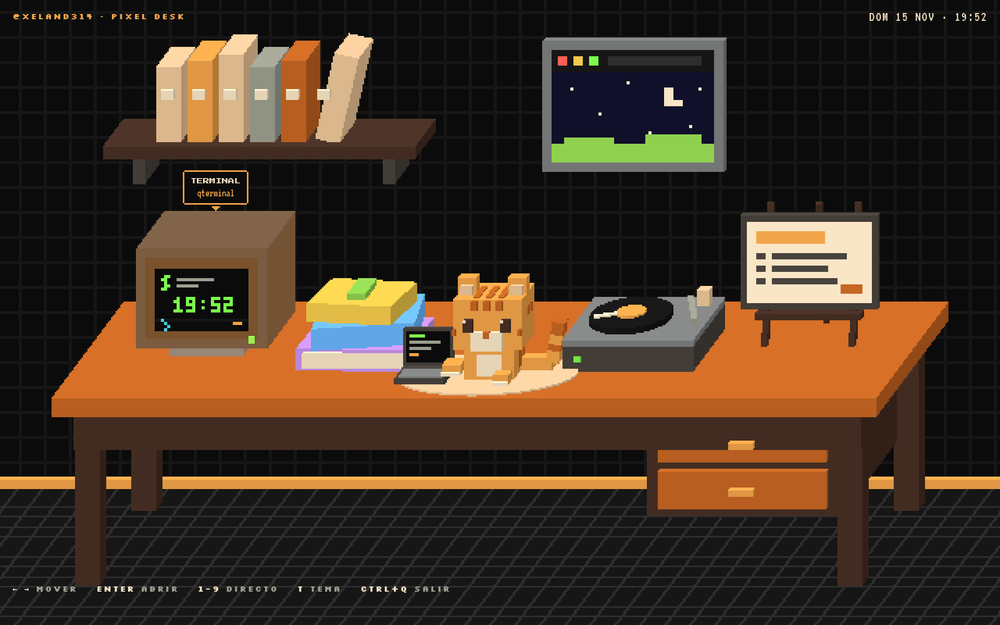
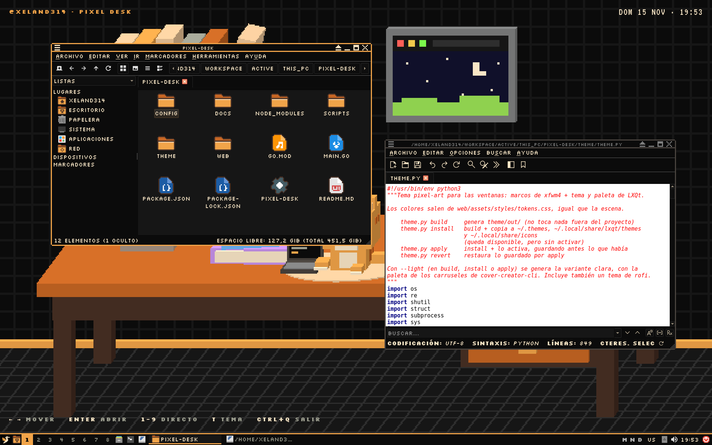
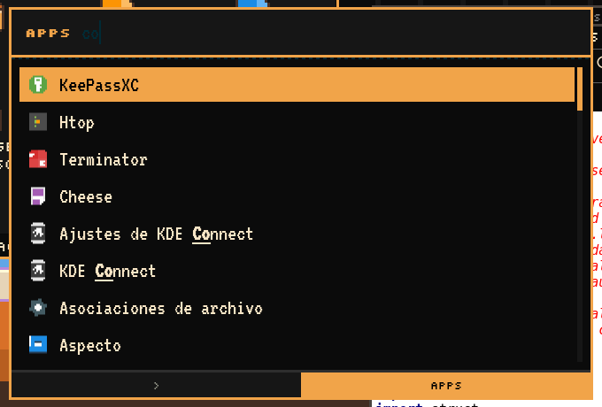
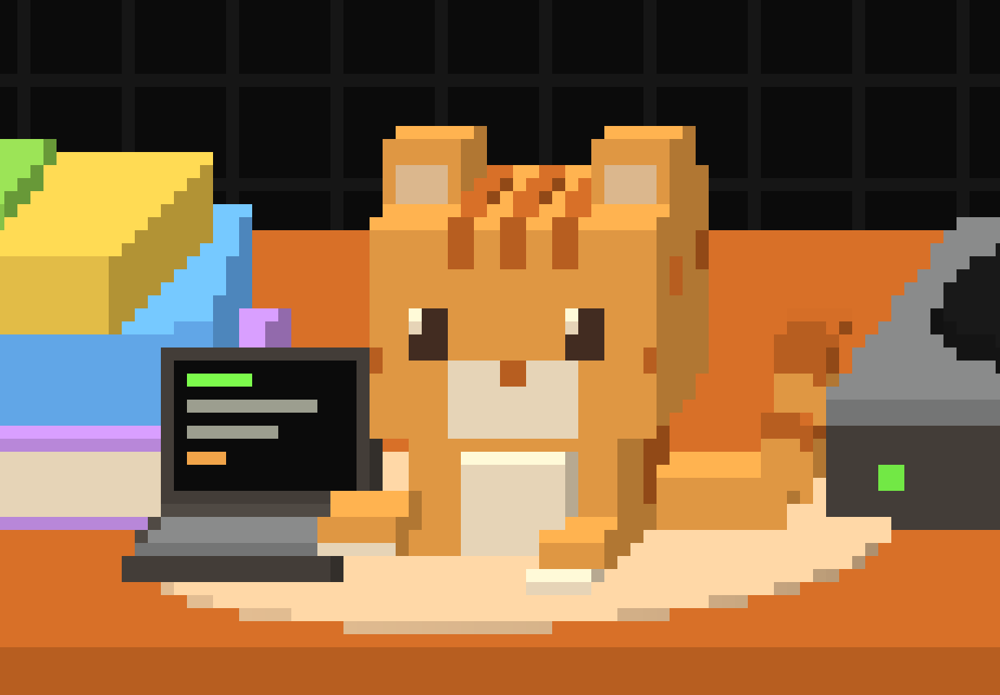

<div align="center">

# 🐈 pixel-desk

**Un escritorio pixel-art 2.5D para Linux (X11).**<br>
Tu fondo de escritorio es una habitación: cada objeto de la mesa abre una app.




</div>

---

## ✨ Qué tiene

<table>
<tr>
<td width="50%" valign="top">

### Una habitación que lanza apps
Pasa el ratón (o usa `← →`) y el objeto salta con su etiqueta. Clic o `Enter`
lo abre. El monitor CRT marca la hora, el cielo de la ventana sigue el día y
los cajones se deslizan hacia fuera.

### Un gato de verdad (bueno, de cajas)
La mascota de la marca, en 3D con la paleta del sprite original. Teclea en su
portátil, mueve la cola y parpadea, todo a 8 pasos por segundo.

</td>
<td width="50%" valign="top">


</td>
</tr>
</table>

### Claro y oscuro
`T` alterna en vivo. El modo claro usa la paleta de los carruseles de
cover-creator-cli: blanco, tinta azul noche y naranja `#f97316`.


### Todo el escritorio a juego
Marcos de ventana, panel, menú, iconos y rofi salen de los mismos tokens de
color que la escena.



<details>
<summary><b>Ver la sesión en modo claro</b></summary>


</details>

---

## 🎛️ Los objetos

| | Objeto | Abre |
|---|---|---|
| 📁 | Carpetas de la repisa | gestor de archivos (`pcmanfm-qt`) |
| 🖥️ | Monitor CRT con reloj | terminal (`qterminal`) |
| 📚 | Pila de libros (colores del resaltado de sintaxis) | VS Code |
| 🐈 | El gato con su portátil | lanzador (`rofi -show drun`) |
| 💿 | Tocadiscos | Spotify, en su escritorio virtual (el 8) |
| 🪟 | Ventana en la pared | navegador (Brave) |
| 🖼️ | Caballete | `slides.c`, el presentador en C |
| 🧰 | Cajón de arriba | ajustes de LXQt |
| 🔑 | Cajón de abajo | apagar / cerrar sesión |

Todo se configura en [`config/apps.json`](config/apps.json). La página solo
envía un `id`; el binario ejecuta únicamente lo que está en esa lista.

**Controles:** ratón · `← →` mover · `Enter` abrir · `1-9` directo · `T` tema · `Ctrl+Q` salir

---

## 🚀 Uso

```bash
nvm use            # .nvmrc → node 22.23.4
npm install        # baja three.js y lo copia a web/vendor/
npm run build      # go build → ./pixel-desk (embebe web/ y config/)

npm start          # ventana normal, sirve web/ desde disco (editar y F5)
npm run desktop    # como fondo de escritorio
npm run stop       # cerrarlo
```

| Opción | Qué hace |
|---|---|
| `-desktop` | ventana `_NET_WM_WINDOW_TYPE_DESKTOP`: detrás de todo, a pantalla completa |
| `-theme light` | arranca en modo claro (por defecto `dark`) |
| `-px N` | tamaño del píxel: `3` por defecto (640×400 en 1920×1200), `6` grueso, `2` fino |
| `-software` | sin aceleración por GPU |
| `-shot f.png` | guarda una captura y sale |
| `-config ruta` | otra lista de apps |

Para arrancarlo con la sesión, una entrada en `~/.config/autostart/`:

```ini
[Desktop Entry]
Type=Application
Name=pixel-desk
Exec=/ruta/a/pixel-desk/pixel-desk -desktop
Path=/ruta/a/pixel-desk
OnlyShowIn=LXQt;
```

---

## 🎨 Tema del escritorio

[`theme/theme.py`](theme/theme.py) genera e instala todo el conjunto, siempre
con copia de seguridad de lo que había:

```bash
python3 theme/icons.py                 # convierte los iconos (ver abajo)
python3 theme/theme.py apply           # instala y activa (guarda lo anterior en theme/backup/)
python3 theme/theme.py apply --light   # variante clara
python3 theme/theme.py revert          # vuelve a como estaba
```

| Pieza | Resultado |
|---|---|
| **xfwm4** `PixelDesk` | marcos de 3 px, esquinas escalonadas, botones con glifos 5×5; naranja la activa, gris las demás |
| **LXQt** `pixel-desk` | panel negro con línea de acento, nada redondeado, paleta Qt a juego, fuente Silkscreen |
| **Menú** | el colibrí de LXQt que trae Debian, redibujado en 12×12 |
| **rofi** | marco de 3 px, selección en bloque, fuente VT323, iconos pixel-art |
| **Iconos** `PixelDesk` | carpetas dibujadas a mano + el resto convertido |

<table>
<tr>
<td></td>
<td></td>
</tr>
</table>

### Carpetas dibujadas a mano

Con emblema para Inicio, Escritorio, Documentos, Descargas, Música, Imágenes,
Vídeos y Red, más el monitor del botón "mostrar escritorio".


### Iconos convertidos, sin IA

[`theme/icons.py`](theme/icons.py) pasa los iconos de Papirus a pixel-art con
un algoritmo determinista:

1. rasteriza el SVG a 8 píxeles por celda;
2. cada celda de la rejilla (16×16, o 12×12 a tamaño de panel) toma su color
   **dominante**, no el promedio, para que los bordes no se enturbien;
3. reduce la paleta del icono por corte de mediana;
4. añade un contorno de una celda con el marrón del gato.

Convierte las apps instaladas, los tipos de archivo y los dispositivos
(~550 iconos en 7 s); `--all` convierte las ~3700 apps de Papirus.


---

## 🧱 Cómo funciona

```
┌───────────────────────── pixel-desk (binario Go, 11 MB) ─────────────────────────┐
│                                                                                  │
│  ventana GTK3 ──► WebKitGTK ──► http://127.0.0.1:<aleatorio>/?t=<token>          │
│  (tipo DESKTOP)                    │                                             │
│                                    ▼                                             │
│                     web/desk.js · three.js                                       │
│                     cajas 3D en proyección oblicua, render a 640×400,            │
│                     escalado ×3 sin suavizado, animación a 8 fps                 │
│                                    │                                             │
│                     POST /api/launch?id=terminal  (cabecera X-Desk-Token)        │
│                                    ▼                                             │
│  lanzador ──► solo ids de config/apps.json ──► setsid qterminal                  │
└──────────────────────────────────────────────────────────────────────────────────┘
```

- **Pixel-art con volumen:** las caras frontales quedan 1:1 con la rejilla de
  píxeles y solo la profundidad se inclina. La luz es fija, así cada cara de una
  caja tiene un único tono, como en un sprite.
- **Sin Electron:** usa el WebKitGTK que ya trae el sistema; se enlaza contra la
  librería de runtime, así que no hace falta el paquete `-dev`.
- **Seguro por defecto:** el servidor escucha solo en `127.0.0.1`, la API exige
  un token nuevo en cada arranque, y la página no puede pedir comandos, solo ids.

<details>
<summary><b>Estructura del proyecto</b></summary>

```
main.go             servidor local + ventana GTK/WebKit + lanzador
config/apps.json    apps lanzables
web/desk.js         la escena (habitación, objetos, gato, selección, entrada)
web/desk.css        HUD y etiquetas
web/assets/styles/  tokens.css (copia de social-media/shared) y light.css
web/assets/fonts/   Press Start 2P, Silkscreen, VT323 (OFL)
web/vendor/         three.js (lo genera npm install)
scripts/            spotify-desk.sh
theme/theme.py      generador e instalador del tema
theme/icons.py      conversión de iconos de Papirus a pixel-art
docs/img/           capturas de este README
```

</details>

---

## 📝 Notas

- Pensado para LXQt + xfwm4 en X11 (Debian 13). En Wayland la ventana tipo
  escritorio no funciona igual.
- Compilar requiere `libgtk-3-dev`; ejecutar, `libwebkit2gtk-4.1-0`.
- El tema no cambia el tema GTK. Las apps con interfaz propia (Brave, VS Code,
  Spotify) solo reciben el marco de ventana, y los iconos de la bandeja los
  dibuja cada app.
- Mientras está abierto tapa el escritorio de pcmanfm-qt (iconos y fondo).
- Los iconos convertidos derivan de [Papirus](https://github.com/PapirusDevelopmentTeam/papirus-icon-theme)
  (GPL-3.0) y se generan en local; no se incluyen en el repositorio.

<div align="center">
<br>

<br>
<sub>hecho por <b>@xeland314</b></sub>
</div>
